<p align="center">
  <a href="https://shuvam-banerji-seal.github.io/"></a>
</p>

<p align="center">
  
</p>

<p align="center">
  <a href="https://shuvam-banerji-seal.github.io/"></a>
  <a href="https://github.com/Shuvam-Banerji-Seal/My-CV/blob/main/Shuvam_Banerji_Seal_CV.pdf"></a>
  <a href="https://huggingface.co/ShuvBan"></a>
  <a href="https://orcid.org/0009-0000-0714-569X"></a>
  <a href="https://www.linkedin.com/in/mastersbs"></a>
  
</p>

<p align="center">
  <a href="#status-window"></a>
  <a href="#worldline-map"></a>
  <a href="#main-quest"></a>
  <br />
  <a href="#lab-gadgets"></a>
  <a href="#side-quests"></a>
  <a href="#send-a-d-mail"></a>
</p>

<p align="center"></p>

## Status Window

<p align="center">
  <a href="https://github.com/Shuvam-Banerji-Seal/My-CV/blob/main/Shuvam_Banerji_Seal_CV.pdf"></a>
</p>

**Lab log.** Final-year BS-MS at IISER Kolkata (chemistry major, computer-science minor, CGPA 8.2). I work where computational chemistry meets machine learning and information retrieval: DFT and molecular dynamics on one side, retrieval-augmented LLMs and how to evaluate them on the other. The MS thesis is where the two worldlines meet.

| | |
|:--|:--|
| **Observing now** | MS thesis (Lean 4 × MoE for RNA) · SycoLex and the FIRE 2026 sycophancy track · Molecule3D |
| **Guilds founded** | [iFiNN](https://synapse-iiserk.github.io/) (AI fintech) and [UnderWater AI](https://underwater-ai.github.io/) (deep-tech), both funded by MeitY Startup Hub through GENESIS and incubated at RISE, IISER Kolkata |
| **Open to** | ML for science · molecular simulation · quantum chemistry · IR and RAG evaluation |
| **Signal** | sbs22ms076@iiserkol.ac.in |

## Worldline Map

<p align="center">
  
</p>

### Recorded worldlines · publications

| Year | Venue | Paper | Links |
|:--:|:--|:--|:--|
| 2026 | **ECIR 2026** | AgriIR: A Scalable Framework for Domain-Specific Knowledge Retrieval · *first author* | [DOI](https://doi.org/10.1007/978-3-032-21324-2_37) · [arXiv](https://arxiv.org/abs/2604.16353) · [code](https://github.com/Shuvam-Banerji-Seal/AgriIR) · [data](https://huggingface.co/datasets/ShuvBan/AgriIR_dataset) |
| 2025 | **FIRE 2025** | Hierarchical Opinion Classification using Large Language Models · *first author* | [paper](https://ceur-ws.org/Vol-4173/T10-3.pdf) |
| 2024 | **TREC 2024** | IISERK@ToT_2024: Query Reformulation and Layered Retrieval for Tip-of-Tongue Items | [paper](https://trec.nist.gov/pubs/trec33/papers/IISER-K.tot.pdf) |
| 2026 | CIKM 2026 Resource Track *(under review)* | SycoLex: A Cross-Jurisdictional Benchmark for Detecting Sycophancy in Legal Case Reasoning | [dataset](https://huggingface.co/datasets/ShuvBan/SycoLex) |
| WIP | *to be submitted* | Computational Modeling of \[VO(SALIEP)(DTP)\] as a Water-Reducing Catalyst (DFT, B3LYP) | |

## Main Quest

<p align="center">
  
</p>

- **Project I · The genome on a Karnaugh map.** DNA, RNA and protein sequences encoded as binary codewords and laid out on Gray-code orderings and Karnaugh maps, so that adjacency on the map is a single-symbol mutation. Then: extract the symmetries and distance structure the encoding induces, test whether they predict biology (codon degeneracy, mutation neighbourhoods, amino-acid classes), and machine-check every theorem in **Lean 4 / Mathlib**.
- **Project II · Sparse experts for RNA structure.** A mixture-of-experts transformer for RNA secondary and tertiary structure, with sparse routing so specialised experts handle helices, loops and pseudoknots at a fixed inference budget. Nucleotide tokenisation, MSA features, geometry-aware attention, distance-map and torsion-angle heads; multi-GPU mixed-precision training with ablations over routing and expert count.

## Lab Gadgets

*Numbered prototypes from the lab. Every one is public; click through.*

<table>
<tr>
<td width="50%" valign="top">
<code>GADGET 01</code> <a href="https://github.com/Shuvam-Banerji-Seal/lammps-web-gui"><b>Molecule3D · LAMMPS Web GUI</b></a> · <a href="https://shuvam-banerji-seal.github.io/lammps-web-gui/">live</a><br/>
<sub>A full LAMMPS workbench in the browser: drag-and-drop script builder over 186 commands, a compiler helper for 27 CMake options, a 3D trajectory viewer and PBC-aware RDF / MSD analysis. Runs client-side; nothing is uploaded.</sub><br/>
<sub><code>TypeScript</code> <code>React</code> <code>Three.js</code> <code>WebGL</code> <code>143 tests</code></sub>
</td>
<td width="50%" valign="top">
<code>GADGET 02</code> <a href="https://github.com/Shuvam-Banerji-Seal/AgriIR"><b>AgriIR</b></a> · <a href="https://doi.org/10.1007/978-3-032-21324-2_37">ECIR 2026</a><br/>
<sub>Reference implementation of the paper: a six-stage configurable RAG pipeline with deterministic citations and domain agents, hybrid BM25 + dense retrieval, and a 15k-entry open agricultural dataset.</sub><br/>
<sub><code>FAISS</code> <code>Ollama</code> <code>BM25</code> <code>RAG</code></sub>
</td>
</tr>
<tr>
<td width="50%" valign="top">
<code>GADGET 03</code> <a href="https://huggingface.co/datasets/ShuvBan/SycoLex"><b>SycoLex</b></a> · <a href="https://sycolex.com/">FIRE 2026 track</a><br/>
<sub>Benchmark for sycophancy in legal reasoning: 1,954 cases across the US Supreme Court, Indian Supreme Court and Indian consumer courts, six sycophancy-inducing prompt variants, five LLMs, LLM-as-judge and human-expert labels. CC-BY-4.0.</sub><br/>
<sub><code>AI safety</code> <code>LLM-as-Judge</code> <code>Hugging Face</code></sub>
</td>
<td width="50%" valign="top">
<code>GADGET 04</code> <a href="https://shuvam-banerji-seal.github.io/iiserkonnect-website/"><b>IISERKonnect</b></a><br/>
<sub>Campus super-app unifying the IISER Kolkata intranet (courses, mess, calendar, grades, library, notices), with hand-written parsers, credentials kept on-device and a serverless WebRTC campus chat. In campus-wide testing with 2,000+ users.</sub><br/>
<sub><code>Kotlin</code> <code>Jetpack Compose</code> <code>WebRTC</code> <code>Playwright</code></sub>
</td>
</tr>
<tr>
<td width="50%" valign="top">
<code>GADGET 05</code> <a href="https://github.com/Shuvam-Banerji-Seal/introduction-to-molecular-simulation"><b>Introduction to Molecular Simulation</b></a><br/>
<sub>Open talk and hands-on course: statistical mechanics, force fields, integrators, thermostats and barostats, NVE / NVT / NPT, and extracting RDF, MSD, VACF and free energies from real LAMMPS runs.</sub><br/>
<sub><code>LAMMPS</code> <code>Marp</code> <code>Python</code></sub>
</td>
<td width="50%" valign="top">
<code>GADGET 06</code> <a href="https://github.com/Shuvam-Banerji-Seal/DFT-notes"><b>DFT Notes</b></a> · <a href="https://shuvam-banerji-seal.github.io/DFT-notes/">live</a><br/>
<sub>Open knowledge base on density functional theory, from the many-body problem through Hartree–Fock, Hohenberg–Kohn and Kohn–Sham to exchange-correlation functionals, each chapter with runnable Python.</sub><br/>
<sub><code>DFT</code> <code>Python</code> <code>Mermaid</code></sub>
</td>
</tr>
<tr>
<td width="50%" valign="top">
<code>GADGET 07</code> <a href="https://github.com/Shuvam-Banerji-Seal/shaders-for-beginners"><b>Shaders for Beginners</b></a> · <a href="https://shuvam-banerji-seal.github.io/shaders-for-beginners/">live</a><br/>
<sub>Eleven lessons in GPU programming from first principles: OpenGL and GLSL, the graphics pipeline, a first look at Vulkan and audio-reactive shaders, with an interactive WebGL editor.</sub><br/>
<sub><code>GLSL</code> <code>WebGL</code> <code>C/C++</code></sub>
</td>
<td width="50%" valign="top">
<code>GADGET 08</code> <a href="https://github.com/Shuvam-Banerji-Seal/ai-in-real-world-context"><b>AI in the Real-World Context</b></a> · <a href="https://shuvam-banerji-seal.github.io/ai-in-real-world-context/">deck</a><br/>
<sub>The 60-minute CBSE district-level talk given to 64 teachers from 38 schools, released as an interactive HTML deck and a Beamer PDF so schools can reuse it.</sub><br/>
<sub><code>HTML slides</code> <code>Beamer</code> <code>TikZ</code></sub>
</td>
</tr>
<tr>
<td width="50%" valign="top">
<code>GADGET 09</code> <a href="https://github.com/Shuvam-Banerji-Seal/opngx"><b>opngx</b></a><br/>
<sub>Pixel-exact extractor for Optronis high-speed-camera <code>.bin</code> recordings that saturates every core with runtime SIMD dispatch. Ships as a CLI, a Tk GUI and a Python library.</sub><br/>
<sub><code>SIMD</code> <code>Python</code> <code>Linux / Windows</code></sub>
</td>
<td width="50%" valign="top">
<code>GADGET 10</code> <a href="https://github.com/Shuvam-Banerji-Seal/C-Programming-for-Beginners"><b>C Programming for Beginners</b></a><br/>
<sub>A 20-module open curriculum from fundamentals to network programming, machine learning in C and GTK4 GUIs.</sub><br/>
<sub><code>C</code> <code>GTK4</code> <code>curriculum</code></sub>
</td>
</tr>
</table>

## Guild Records

<p align="center">
  
</p>

## Item Box

<p align="center">
  
</p>

<details>
<summary><b>Full skill list (plain text)</b></summary>

- **Computational chemistry and materials:** DFT · Quantum ESPRESSO (SCF, relaxation, band structure, DOS, phonons) · Gaussian (B3LYP, basis sets, transition-state search) · VASP workflows · ORCA · LAMMPS · GROMACS · VMD · OVITO · force fields (AIREBO, ReaxFF, EAM, Lennard-Jones) · Monte Carlo · RDF, MSD and free-energy analysis
- **Structural biology and bioinformatics:** RNA secondary and tertiary structure · protein and nucleic-acid structure prediction · PyMOL · ChimeraX · AutoDock Vina · molecular docking
- **ML and deep learning:** PyTorch · TensorFlow · transformers · mixture-of-experts · LoRA / QLoRA · distributed and mixed-precision training · Gaussian processes · XGBoost · scikit-learn
- **LLMs, RAG and agents:** hybrid dense + sparse retrieval · FAISS · ChromaDB · LangChain · Ollama · vLLM · Hugging Face Hub and Datasets · LLM-as-a-Judge · sycophancy and bias evaluation · Qwen · Gemma · DeepSeek · LLaMA
- **Formal methods:** Lean 4 and Mathlib · machine-checked proofs · Boolean algebra and Gray codes · combinatorics on words
- **Languages:** Python · C / C++ · Kotlin · TypeScript / JavaScript · Java · Rust · Fortran · Lean 4 · Bash · SQL
- **Engineering:** React · Three.js / React Three Fiber · WebGL and GLSL · Vite · Django · Flask · Node.js · WebRTC · Android (Jetpack Compose) · GTK4 · Docker · CMake · GitHub Actions · Playwright · Vitest
- **HPC and systems:** OpenMP · MPI · CUDA · SLURM-style clusters · Arch Linux · systemd
- **Lab bench:** UV-Vis · ATR-FTIR · TGA · DSC · XRD · GC-MS · fluorimetry · SEM · TEM · AFM

</details>

## Lab Charter

> **First principles, then force fields.** Every simulation is an argument about reality. I compute to *test* the argument, not to decorate it. If the HOMO–LUMO gap disagrees with the experiment, the gap is not wrong: the model is.

> **Retrieval over memorisation.** A model that cannot cite its sources is an opinion engine. Whether it is a language model or a spectroscopy reference, the answer must trace back to evidence.

> **Ship the negative result.** The failed catalyst, the ablation that lost, the retrieval run that underperformed BM25: these are data. Science compounds only when the null results are public.

## Side Quests

*Choose-your-path labs built from my own research. Open a step, pick a branch; wrong paths teach too.*

### Side Quest I · Synthesize the catalyst from the DFT study

<details>
<summary><strong>Step 1: Choose your central metal</strong></summary>

> You need a redox-active transition metal capable of oxo-coordination for water reduction.

- <details><summary>Select Vanadium (V)</summary>

  Correct instinct. Vanadium(IV) oxo-complexes are known water-reduction catalysts, and the d¹ electron gives you an EPR handle too.

  - <details><summary>Add Salen-type ligand (SALIEP)</summary>

    SALIEP provides strong N/O donors that stabilise V(IV). Now choose the co-ligand.

    - <details><summary>Add dithiophosphate (DTP)</summary>

      **You built [VO(SALIEP)(DTP)]**, the exact target complex from the DFT/B3LYP study.
      Run Gaussian with B3LYP/6-311G(d,p), compute MO energies, map the water-reduction pathway.
      The V=O stretch should land near 965 cm⁻¹; if it does, your geometry converged.
    </details>
    - <details><summary>Add bipyridine (bpy)</summary>

      Interesting coordination, but bpy makes the complex too inert for proton-coupled electron transfer here. Swap in dithiophosphate (DTP).
    </details>
  </details>

  - <details><summary>Add only H₂O as ligand</summary>

    Water alone will not chelate stably; it exchanges too fast. Try a stronger donor like SALIEP.
  </details>
</details>

- <details><summary>Select Iron (Fe)</summary>

  Iron catalyses plenty of chemistry, but this specific DFT study uses vanadium. Try again.
</details>

- <details><summary>Select Zinc (Zn)</summary>

  d¹⁰: diamagnetic and redox-silent. No unpaired electron, no EPR signal, no water reduction here. Pick a metal with available d-electrons.
</details>

</details>

### Side Quest II · Build the hybrid RAG pipeline (ECIR 2026)

<details>
<summary><strong>Step 1: Choose your retriever</strong></summary>

- <details><summary>Dense retrieval only (vector embeddings)</summary>

  Handles semantic similarity well, but misses exact keyword matches for rare technical terms. Upgrade?

  - <details><summary>Add BM25 sparse retrieval in parallel</summary>

    Now you have hybrid retrieval. How do you merge the two ranked lists?

    - <details><summary>Reciprocal Rank Fusion (RRF)</summary>

      **Perfect.** RRF combines ranked lists without score calibration. Add HyDE (hypothetical document embeddings) for query refinement and wrap it in a Streamlit UI, and you have rebuilt the IISER-K intranet system.
    </details>
    - <details><summary>Weighted linear score combination</summary>

      Works, but needs per-domain score calibration, which is brittle across corpora. RRF is more robust. Try again.
    </details>
  </details>
</details>

- <details><summary>BM25 sparse only</summary>

  Fast and interpretable, but misses paraphrases. Upgrade to hybrid for better recall.
</details>

- <details><summary>Fine-tune a cross-encoder re-ranker on 50 labelled queries</summary>

  Legitimate architecture, but with 50 labels you will overfit in an afternoon. Hybrid + RRF gets you further with zero labels. Try the label-free path first.
</details>

</details>

### Side Quest III · Run the MD simulation (LAMMPS)

*Solvate the vanadium complex and keep it intact for 500 ns. Three choices, one stable trajectory.*

<details>
<summary><strong>Step 1: Pick the ensemble</strong></summary>

- <details><summary>NVT (fixed volume, thermostat only)</summary>

  Stable and simple. With fixed volume you cannot model the solvent density change as the complex relaxes, but it is fine for a first equilibration. Proceed.

  - <details><summary>Thermostat: Nosé–Hoover</summary>

    Smooth, deterministic, canonical ensemble. Now the integration timestep:

    - <details><summary>2 fs with constrained bonds (SHAKE)</summary>

      **Stable trajectory.** Constraints remove the fast X–H vibrations, 2 fs resolves the V=O stretch, and over 500 ns the RMSD plateaus near 1.2 Å: complex intact, no dissociation. This is the production setup.
    </details>
    - <details><summary>5 fs bare (no constraints)</summary>

      Blown up. The O–H stretch has a period of about 10 fs; a 5 fs step integrates it as energy gain and your simulation detonates within picoseconds. Constrain bonds and drop to 2 fs.
    </details>
  </details>

  - <details><summary>Thermostat: direct velocity rescaling every step</summary>

    It will hold the temperature, but it distorts the dynamics and gives the wrong fluctuation statistics. Nosé–Hoover samples the canonical ensemble properly.
  </details>
</details>

- <details><summary>NVE (no thermostat)</summary>

  Pure Newtonian dynamics: beautiful, but any drift from the equilibrated state never gets corrected. Use NVT for production.
</details>

</details>

### Side Quest IV · Lay the genome on a Karnaugh map (MS thesis)

*Give each DNA base a 2-bit code so that the commonest point mutations, the transitions A↔G and C↔T, are single bit flips: neighbours on the map.*

<details>
<summary><strong>Step 1: Choose the encoding</strong></summary>

- <details><summary>A = 00, C = 01, G = 11, T = 10 (alphabetical along the Gray sequence)</summary>

  Tidy, but A↔G is 00↔11 and C↔T is 01↔10, so both transitions cost two flips. Your map would put the commonest mutations diagonally apart. Try again.
</details>

- <details><summary>A = 00, G = 01, C = 10, T = 11</summary>

  Correct. A↔G is 00↔01 and C↔T is 10↔11: each transition is one bit. Now scale up to codons: three bases, six bits, a 64-cell map. How do you order each axis?

  - <details><summary>Plain binary: 000, 001, 010, 011, 100, …</summary>

    011 → 100 flips three bits at once, so neighbouring cells would no longer be single mutations. Use a reflected code.
  </details>

  - <details><summary>Reflected Gray code: 000, 001, 011, 010, 110, 111, 101, 100</summary>

    **Map built.** Every pair of neighbouring cells, wrap-around included, now differs in exactly one bit, which is exactly one point mutation.

    The fine print: the arrow only goes one way. A↔T (00↔11) is a perfectly real point mutation that costs two flips, so not every point mutation is a neighbour. A one-way implication like that is exactly what you want a proof assistant to keep you honest about:

    ```lean
    def gray (n : ℕ) : ℕ := n ^^^ (n >>> 1)
    -- consecutive Gray codewords differ in exactly one bit
    ```
  </details>
</details>

- <details><summary>One-hot, 4 bits per base (A = 1000, C = 0100, …)</summary>

  Every substitution flips exactly two bits, so transitions and transversions look identical and the map loses the structure you wanted. It also needs 12 variables per codon. Go compact.
</details>

</details>

## Send a D-mail

*One worldline, shared by every visitor. Press a button and GitHub opens a pre-filled issue; hit **Submit new issue**. A GitHub Action plays the lab PC: it applies your D-mail, redraws the meter, logs you below and closes the issue, usually within a minute.*

<p align="center">
  <a href="https://github.com/Shuvam-Banerji-Seal/Shuvam-Banerji-Seal/issues/new?title=dmail%7Calpha&body=Press%20%22Submit%20new%20issue%22.%20The%20lab%20PC%20%28a%20GitHub%20Action%29%20shifts%20the%20shared%20worldline%20toward%20%CE%B1%20%28chemistry%29%2C%20redraws%20the%20meter%20on%20the%20profile%20and%20closes%20this%20issue."></a>
  <a href="https://github.com/Shuvam-Banerji-Seal/Shuvam-Banerji-Seal/issues/new?title=dmail%7Cbeta&body=Press%20%22Submit%20new%20issue%22.%20The%20lab%20PC%20%28a%20GitHub%20Action%29%20shifts%20the%20shared%20worldline%20toward%20%CE%B2%20%28AI%20%2F%20ML%29%2C%20redraws%20the%20meter%20on%20the%20profile%20and%20closes%20this%20issue."></a>
  <a href="https://github.com/Shuvam-Banerji-Seal/Shuvam-Banerji-Seal/issues/new?title=dmail%7Csteins&body=Press%20%22Submit%20new%20issue%22.%20The%20lab%20PC%20%28a%20GitHub%20Action%29%20pulls%20the%20shared%20worldline%20halfway%20back%20toward%20Steins%20Gate%20%281.048596%29%2C%20redraws%20the%20meter%20on%20the%20profile%20and%20closes%20this%20issue."></a>
</p>

<!-- DMAIL:START -->
<p align="center"></p>

| D-mail | Observer | Shift | Worldline | Date |
|:--:|:--|:--|:--|:--|
| — | *no D-mails yet: be the first observer* | | | |
<!-- DMAIL:END -->

<sub>Rules: α and β D-mails move the value by a pseudo-random 0.01–0.10, seeded by issue number and username. The Steins Gate button halves the distance to 1.048596 and snaps onto it once within 0.0005. Below 1 is the α field; 1 and above is β.</sub>

## Telemetry

<p align="center">
  
  
</p>

<p align="center">
  
</p>

<p align="center">
  
</p>

<p align="center">
  
</p>

<p align="center">
  
</p>

<p align="center">
  <a href="https://shuvam-banerji-seal.github.io/"></a>
  <a href="https://www.linkedin.com/in/mastersbs"></a>
  <a href="https://huggingface.co/ShuvBan"></a>
  <a href="https://twitter.com/TechLitMaster"></a>
  <a href="https://instagram.com/shuvam.banerji_seal"></a>
  <a href="https://www.quora.com/profile/Shuvam-Banerji-Seal"></a>
</p>
